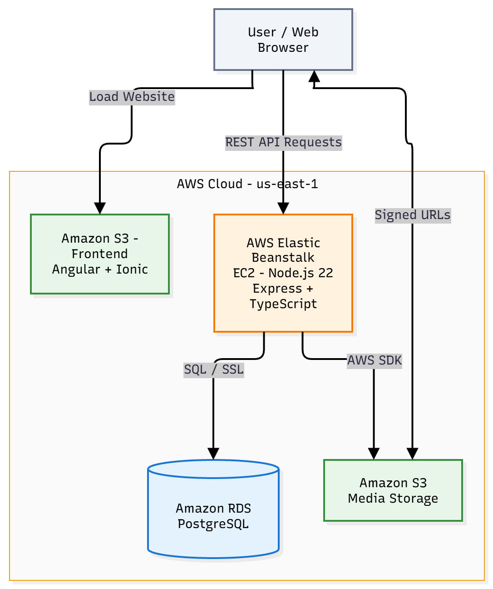
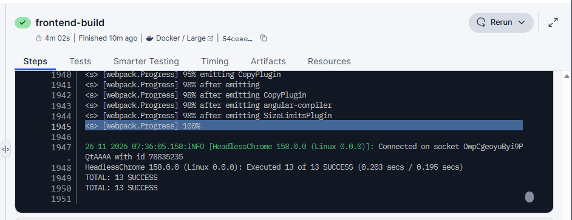
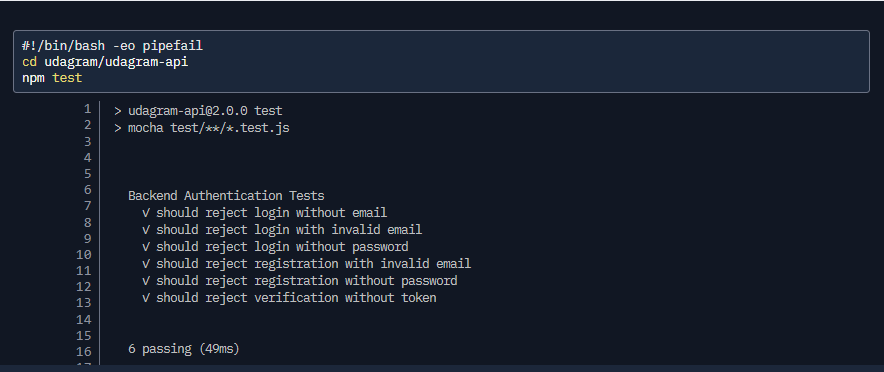
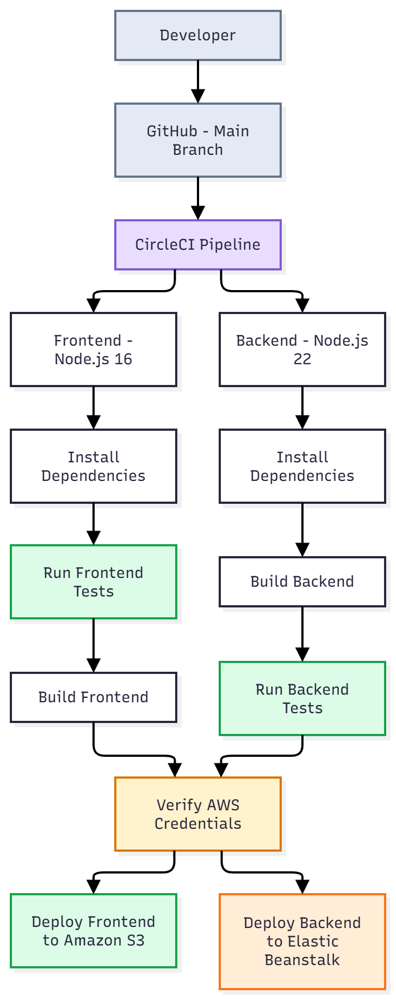
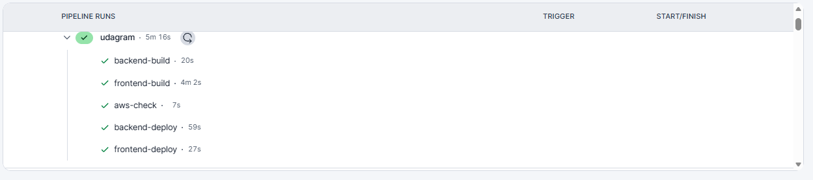
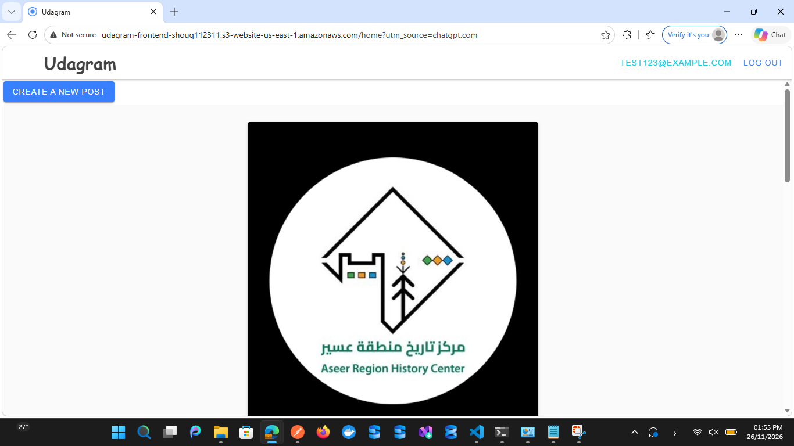

# Udagram – Hosting a Full-Stack Application

## Project Overview

This project is part of the Udacity Full Stack JavaScript Developer Nanodegree. It demonstrates the deployment of a full-stack web application using AWS cloud services and an automated CI/CD pipeline with CircleCI.

Udagram allows users to register, log in, upload images, and view shared posts.

## Live Application

- [Frontend Application](http://udagram-frontend-shouq112311.s3-website-us-east-1.amazonaws.com)
- [Backend API](http://udagram-api-env.eba-tcpqvm3m.us-east-1.elasticbeanstalk.com/api/v0/)

## Technologies Used

- Angular
- Ionic
- TypeScript
- Node.js
- Express.js
- PostgreSQL
- Sequelize
- Amazon S3
- AWS Elastic Beanstalk
- Amazon RDS
- CircleCI
- GitHub

## Application Architecture

The application is deployed in the AWS us-east-1 region.

- **Amazon S3:** Hosts the frontend application.
- **AWS Elastic Beanstalk:** Hosts the backend REST API.
- **Amazon RDS:** Provides the PostgreSQL database.
- **Amazon S3 Media Bucket:** Stores uploaded images.
- **CircleCI:** Automates testing, building, and deployment.



## Prerequisites

- Node.js 16.20.x for the frontend
- Node.js 22.x for the backend
- npm
- AWS CLI
- Elastic Beanstalk CLI
- PostgreSQL
- Google Chrome for frontend tests

## Installation

Clone the repository:

```bash
git clone https://github.com/shouq112311/Udagram-Deployment.git
cd Udagram-Deployment
```

### Frontend

Using Node.js 16:

```bash
npm run frontend:install
npm run frontend:start
```

### Backend

Using Node.js 22:

```bash
npm run api:install
npm run api:start
```

Configure the required backend environment variables before starting the API.

## Environment Variables

The backend requires the following environment variables:

- POSTGRES_USERNAME
- POSTGRES_PASSWORD
- POSTGRES_DB
- POSTGRES_HOST
- AWS_REGION
- AWS_PROFILE
- AWS_BUCKET
- JWT_SECRET
- URL

Sensitive credentials are not included in the source code.

## Testing

### Frontend Tests

Using Node.js 16:

```bash
cd udagram/udagram-frontend
npm run test -- --browsers=ChromeHeadless
```

**Result: 13 tests passed.**



### Backend Tests

Using Node.js 22:

```bash
cd udagram/udagram-api
npm run build
npm test
```

**Result: 6 tests passed.**



A total of 19 automated tests passed successfully.

## Build

Build the frontend using Node.js 16:

```bash
npm run frontend:build
```

Build the backend using Node.js 22:

```bash
npm run api:build
```

Run these commands from the repository root.

## CI/CD Pipeline

The CircleCI pipeline automatically runs when changes are pushed to GitHub. Deployment is restricted to the main branch.

The pipeline includes:

1. Install frontend and backend dependencies.
2. Run frontend automated tests.
3. Build the frontend application.
4. Build the backend application.
5. Run backend automated tests.
6. Verify AWS credentials.
7. Deploy the frontend to Amazon S3.
8. Deploy the backend to AWS Elastic Beanstalk.



### Successful Deployment



## Project Documentation

- [Infrastructure Description](docs/infrastructure.md)
- [Application Dependencies](docs/dependencies.md)
- [CI/CD Pipeline Description](docs/pipeline.md)

## AWS Deployment Screenshots

- [S3 Frontend Hosting](screenshots/s3-static-website.png)
- [S3 Media Storage](screenshots/s3-media-bucket.png)
- [Elastic Beanstalk Environment](screenshots/elastic-beanstalk.png)
- [RDS PostgreSQL Database](screenshots/rds-database.png)
- [CircleCI Environment Variables](screenshots/circleci-environment-variables.png)

## Deployed Application



## Known Limitations

- The frontend and backend require different Node.js versions because of legacy frontend dependencies.
- The application currently uses HTTP for educational deployment purposes.
- Elastic Beanstalk reports an Auto Scaling IAM permission warning due to restricted lab permissions. The backend API was verified to be operational.
- Temporary AWS credentials must remain valid for automated deployment.

## License

[License](LICENSE.txt)
